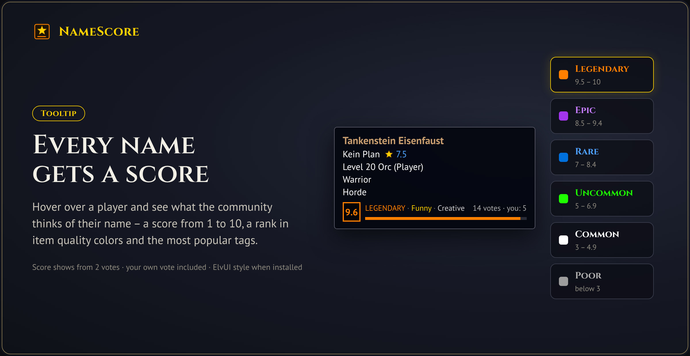
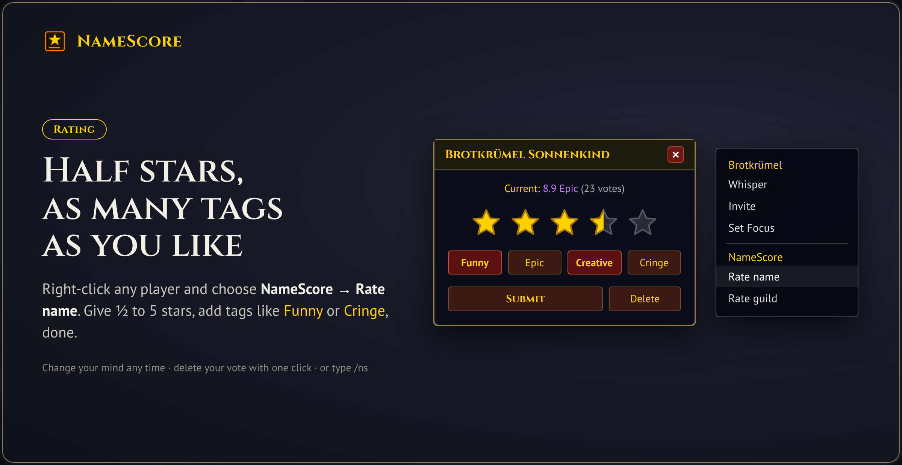
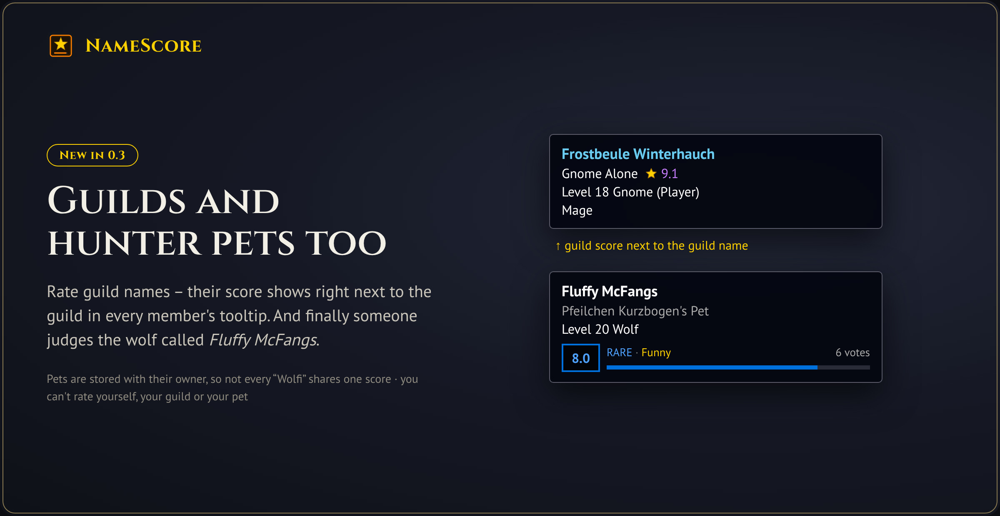
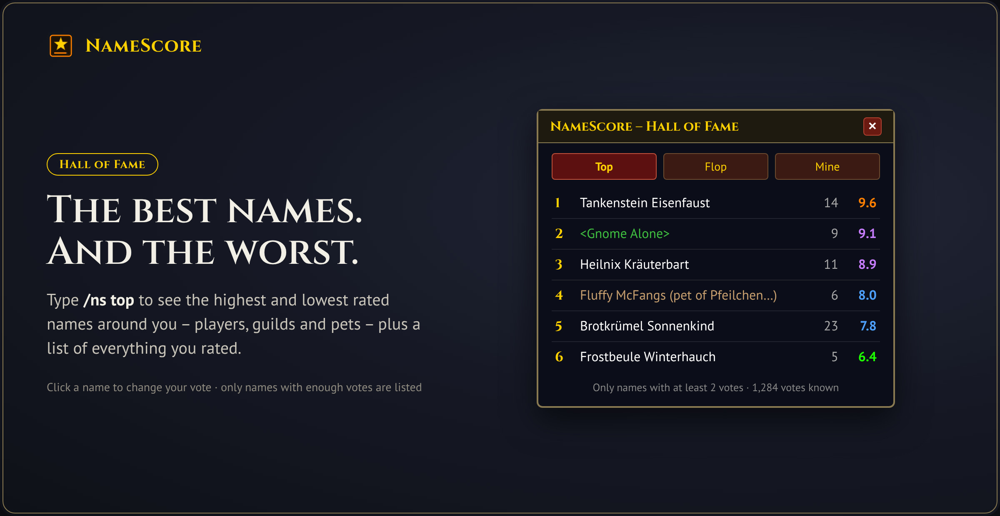
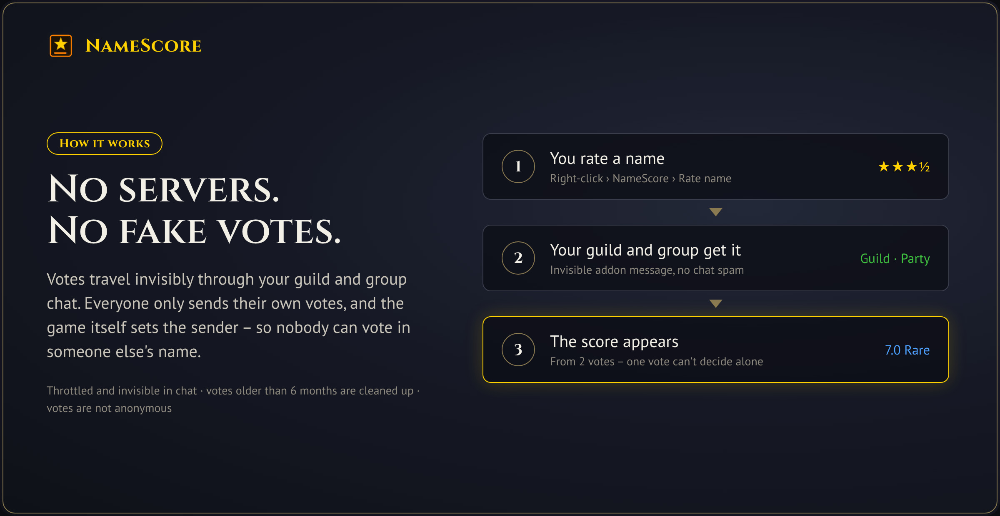

## Rate names. See the score.

Ever met a *Tankenstein*, a guild called *Kein Plan* or a wolf named *Fluffy McFangs* and wished you could tell the world what you think? **NameScore** lets you and your guild rate the names of players, guilds and hunter pets – and shows the community score right in the tooltip, Raider.io style.

- **Score from 1 to 10** with a rank in item quality colors, from *Poor* to *Legendary*
- **Top tags** like *Funny*, *Epic*, *Wordplay*, *Lore*, *Cute* or *Cringe*
- **Your own vote** in the tooltip, so you know who you already rated
- **Your own score:** see what others think of your name, guild and pets
- **Fair:** a score only shows up once a name has at least 2 votes (adjustable)
- **Respectful:** anyone who doesn't want to be rated can opt out with one click

Made for **World of Warcraft: Forever**.

## Rating takes two clicks

Right-click any player and choose **NameScore → Rate name** (or target them and type `/ns`). Give ½ to 5 stars – click the left half of a star for a half star – and add as many tags as you like. Changed your mind? Open it again and change or delete your vote.

## Guilds and hunter pets

- **Guild names:** right-click a player and choose **Rate guild**. The guild score appears right next to the guild name in every member's tooltip.
- **Hunter pets:** pets (and warlock demons) get their own score. They are stored together with their owner, so not every "Wolfi" shares one score.
- You can't rate yourself, your own guild or your own pet. ;)

## Hall of Fame

Click the **minimap button** (or type `/ns top`) for the best and worst rated names around you – players, guilds and pets – and a list of everything you rated. Click a name to change your vote. The **Me** tab shows what others think of you – without the names of the voters.

## How sharing works

There are no external servers. Votes travel invisibly through your **guild** and **party/raid** chat – throttled and never visible in the chat window.

- Each player only sends their **own** votes, and the game itself sets the sender – nobody can fake votes on behalf of others.
- When you log in or join a group, NameScore asks the others for their votes – and only fetches what it doesn't have yet. You see votes from guild and group members who are (or were) online at the same time as you.
- Votes older than 6 months are cleaned up automatically.
- WoW: Forever does not allow addon messages in custom chat channels, so there is no cross-guild sync channel.

**Votes are not anonymous.** Each vote is stored with the voter's name to prevent fake votes. In-game NameScore only shows the average and the number of votes, but anyone with the addon could look up who rated whom in the saved variables.

## Commands

| Command | What it does |
|---|---|
| `/ns` | Open the rating window for your target (player or pet) |
| `/ns 3.5 funny creative` | Rate your target with 3.5 stars and tags directly |
| `/ns guild` | Rate your target's guild |
| `/ns delete` | Delete your vote for your target |
| `/ns top` | Open the hall of fame |
| `/ns me` | What others think of you |
| `/ns options` | Open the settings |
| `/ns minimap` | Show/hide the minimap button |
| `/ns check Name` | Look up a player's score |
| `/ns users` | How many online guild members use NameScore |
| `/ns optout` / `/ns optin` | Don't let others rate you / allow it again |
| `/ns sync` | Request votes from your guild and group |

## Settings

Key bindings for rating your target and the hall of fame are in **Options → Key Bindings → AddOns**. The settings are in **Options → AddOns → NameScore**: tooltip badge on/off and its size (one text line, normal or large), show your own vote, votes needed for a score, and the UI style.

**ElvUI & EllesmereUI:** NameScore windows automatically match your UI. With **EllesmereUI** they follow your theme, accent color and font through its official skinning API (toggle it under *Blizzard Skins+ → Window Skins → Third-Party Addons*). With **ElvUI** they use its borders, fonts and colors.

## Language

English, German, French and Spanish, following your game client's language. More translations are welcome!

## Keep it fun

NameScore rates **names, not people** – it's meant as a bit of fun among friends. There are deliberately no free-text comments, and the lowest rating is called *Cringe* rather than anything nastier.

**Don't want to be rated?** Type `/ns optout` or tick *Don't rate me* in the settings. Everyone with NameScore 0.5 or newer then hides your score and that of your pets and accepts no new ratings. Changed your mind? `/ns optin` allows it again – and all earlier votes are back. Please don't use scores to mock other players in chat.

## Feedback & source

Found a bug or have an idea? Open an issue on [GitHub](https://github.com/Drakner-chio/NameScore).
