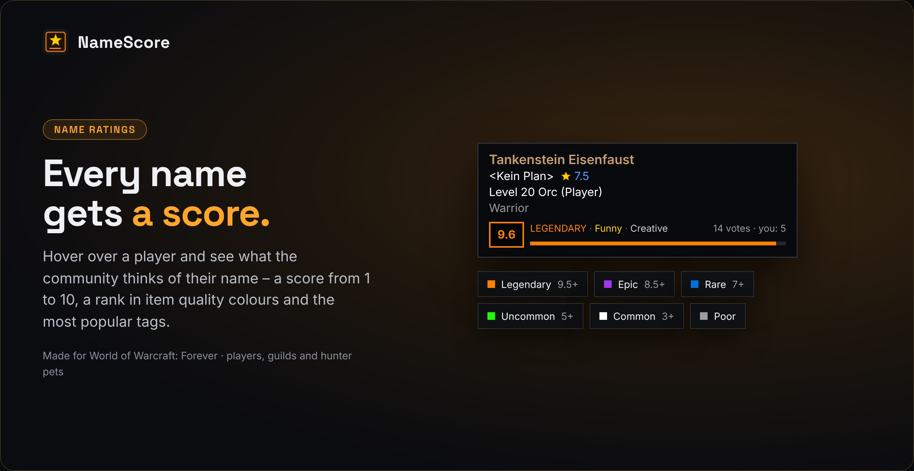
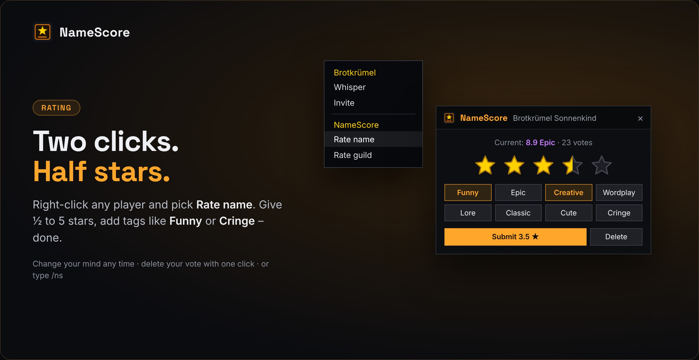
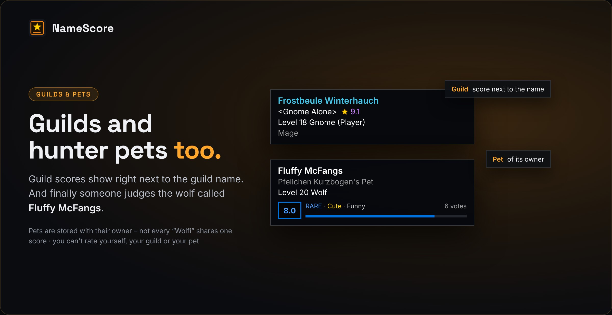
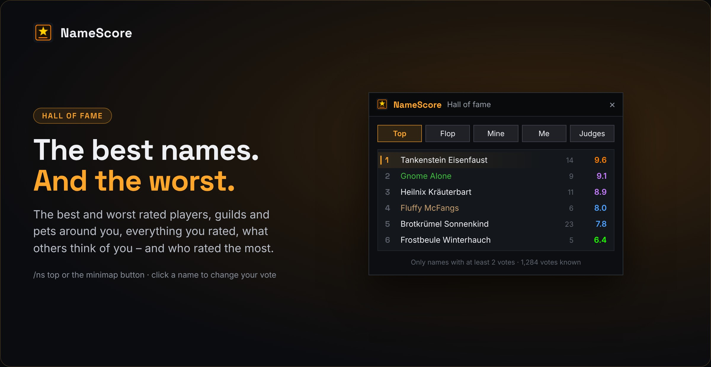
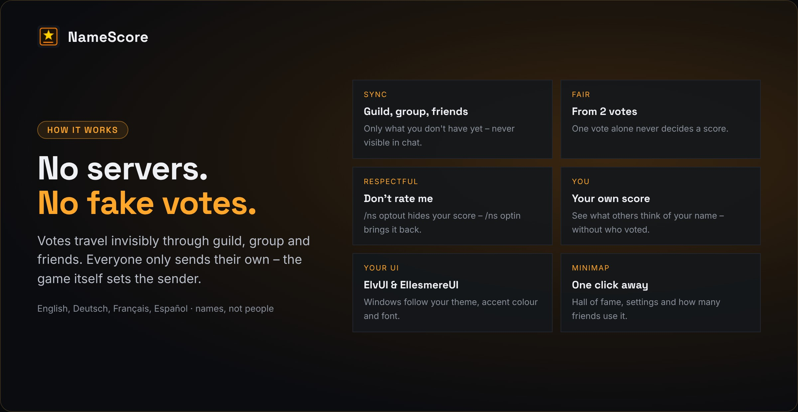

## Every name gets a score

Ever met a *Tankenstein*, a guild called *Kein Plan* or a wolf named *Fluffy McFangs* and wished you could tell the world what you think? **NameScore** lets you and your guild rate the names of **players, guilds and hunter pets** – and shows the community score right in the tooltip, Raider.io style.

- **Score from 1 to 10** with a rank in item quality colours, from *Poor* to *Legendary*
- **Top tags** like *Funny*, *Epic*, *Wordplay*, *Lore*, *Cute* or *Cringe*
- **Your own vote** in the tooltip, so you know who you already rated
- **Fair:** a score only shows once a name has at least 2 votes
- **Respectful:** anyone who doesn't want to be rated can opt out with one command
- **No servers:** votes travel invisibly through guild, group and friends

Made for **World of Warcraft: Forever**. English, German, French and Spanish.

## Two clicks. Half stars.

Right-click any player and pick **NameScore → Rate name** – or target them and type `/ns`. Give ½ to 5 stars (click the left half of a star for a half star) and add as many tags as you like. Changed your mind? Open it again and change or delete your vote.

## Guilds and hunter pets too

- **Guild names:** right-click a player and pick **Rate guild** – the guild score shows right next to the guild name in every member's tooltip
- **Hunter pets** (and warlock demons) get their own score, stored with their owner – not every "Wolfi" shares one score
- You can't rate yourself, your own guild or your own pet ;)

## The best names. And the worst.

Click the **minimap button** or type `/ns top`:

- **Top** and **Flop:** the best and worst rated players, guilds and pets around you
- **Mine:** everything you rated – click a name to change your vote
- **Me:** what others think of your name, your guild and your pets – score, top tags and how many votes gave how many stars, without the names of the voters

## Become a High Warlord – of names

Every name you rate makes you a better judge: **14 judge ranks** from 1 to 1000 rated names, modelled on the old PvP ranks of your faction – with a twist. Start as *Scout of Names* or *Private of Pseudonyms*, climb through *Sergeant of Syllables*, *Knight of Nicknames* and *Warlord of Wordplay*, and end as **High Warlord of Names** or **Grand Marshal of Names**.

- **Judges tab** in the hall of fame: who in your guild, group and friends rated the most names
- Your rank shows in your tooltip, on the *Me* tab and on the minimap button
- Every name counts once – deleting or old votes never lower your rank
- Only the number is shared; switch off *Show me in the judges list* if you'd rather not appear

## No servers. No fake votes.

Votes travel invisibly through your **guild**, your **party/raid** and **whispers to online friends** – throttled and never visible in the chat window.

- **Only your own:** each player only sends their own votes, and the game itself sets the sender – nobody can vote in someone else's name
- **Only what's new:** when you log in or join a group, NameScore only fetches the votes you don't have yet
- **Friends from other guilds:** online friends on your friend list who use NameScore swap votes with you too (`/ns friends` to switch it off)
- **Your UI:** with **EllesmereUI** the windows follow your theme, accent colour and font through its official skinning API; with **ElvUI** they use its borders, fonts and colours
- **Update hint:** when someone in your guild or group has a newer release, you get one short note
- Votes older than 6 months are cleaned up by themselves

WoW: Forever doesn't allow addon messages in custom chat channels, so there is no public channel – you see votes from people you share a guild, a group or a friend list with.

## Keep it fun

NameScore rates **names, not people** – a bit of fun among friends. There are deliberately no free-text comments, and the lowest tag is *Cringe* rather than anything nastier. Please don't use scores to mock other players in chat.

**Don't want to be rated?** Type `/ns optout` or tick *Don't rate me* in the settings: everyone with NameScore 0.5 or newer hides your score and that of your pets and accepts no new ratings. `/ns optin` allows it again – and all earlier votes are back.

**Votes are not anonymous.** Each vote is stored with the voter's name to prevent fake votes. In the game NameScore only shows averages and counts, but anyone with the addon could look up who rated whom in the saved variables.

## Commands

| Command | What it does |
|---|---|
| `/ns` | Rate your target (player or pet) |
| `/ns 3.5 funny creative` | Rate your target directly with stars and tags |
| `/ns guild` | Rate your target's guild |
| `/ns delete` | Delete your vote for your target |
| `/ns top` | Hall of fame |
| `/ns me` | What others think of you |
| `/ns check Name` | Look up a player's score |
| `/ns users` | How many online guild members use NameScore |
| `/ns optout`, `/ns optin` | Don't let others rate you / allow it again |
| `/ns judges` | Your judge rank and the top judges |
| `/ns friends` | Sync with online friends on/off |
| `/ns sync` | Ask guild, group and friends for new votes |
| `/ns minimap` | Show or hide the minimap button |
| `/ns options` | Settings: badge on/off and size, own vote, votes needed, UI style, … |

Minimap button: left click opens the hall of fame, right click the settings. Key bindings for *Rate target* and the hall of fame are under **Options → Key Bindings → AddOns**. Commands and tags also work in German (`/ns gilde`, `/ns ich`, `lustig`, `süß`, …).

## Source

[github.com/Drakner-chio/NameScore](https://github.com/Drakner-chio/NameScore) – MIT licence. Bugs, ideas and translations welcome as issues.
